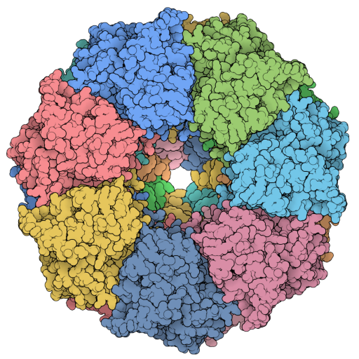
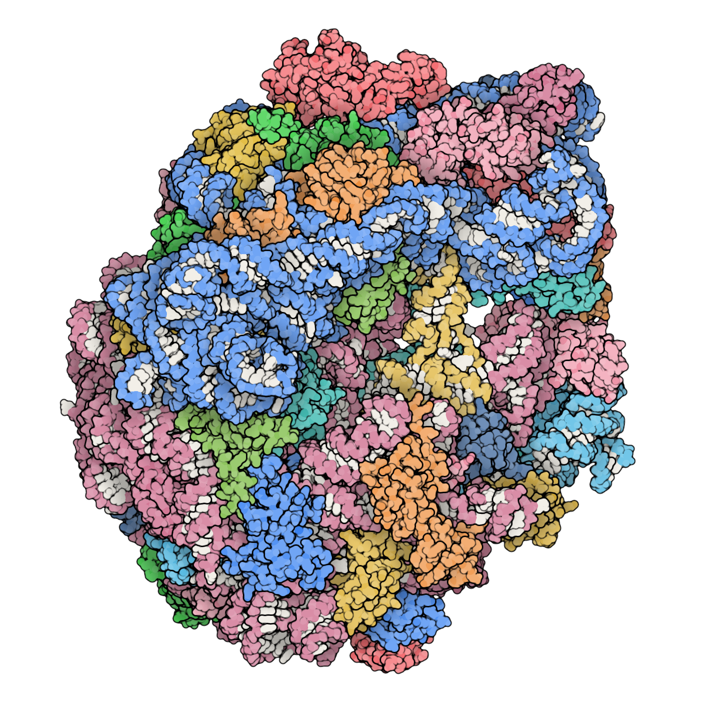
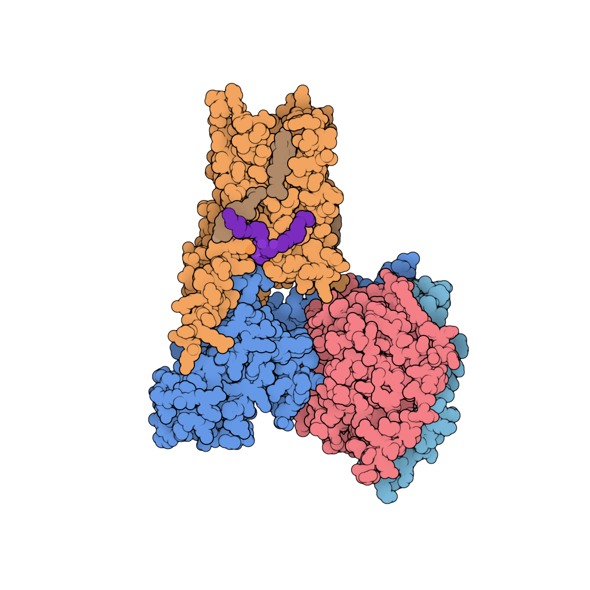
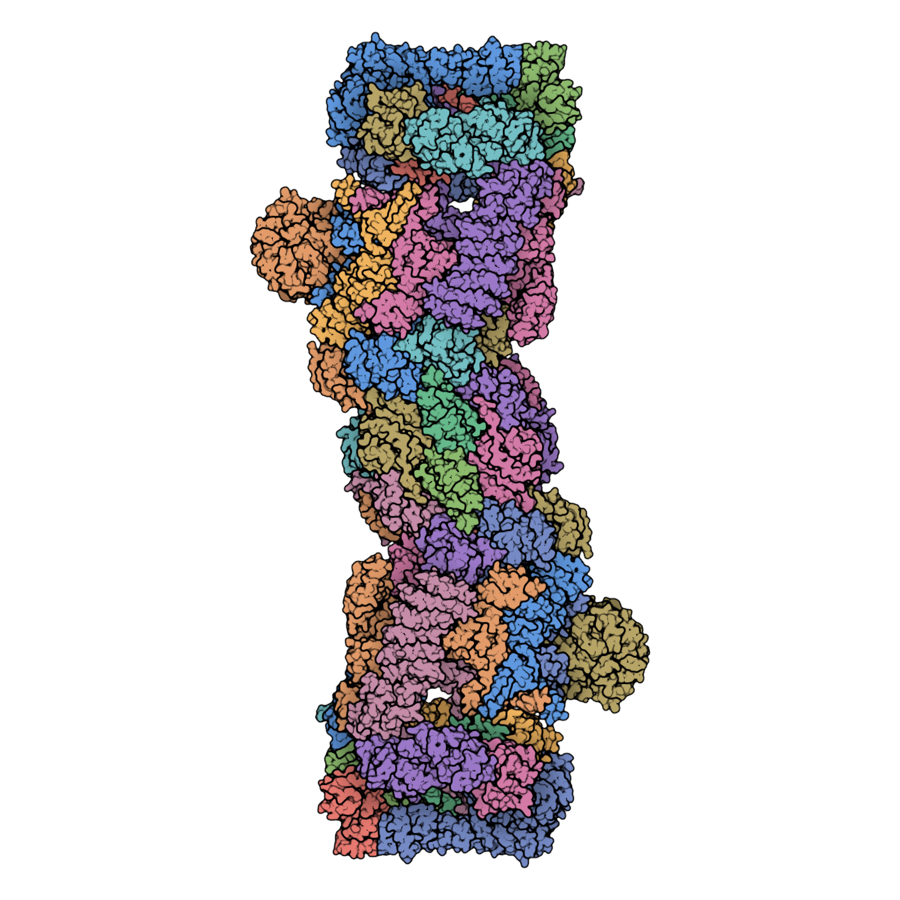
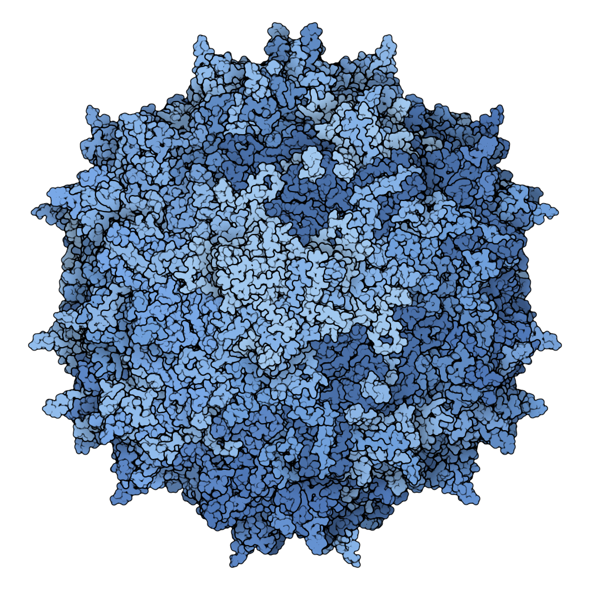
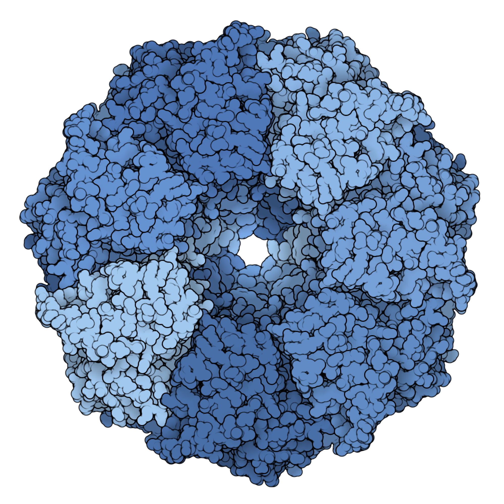
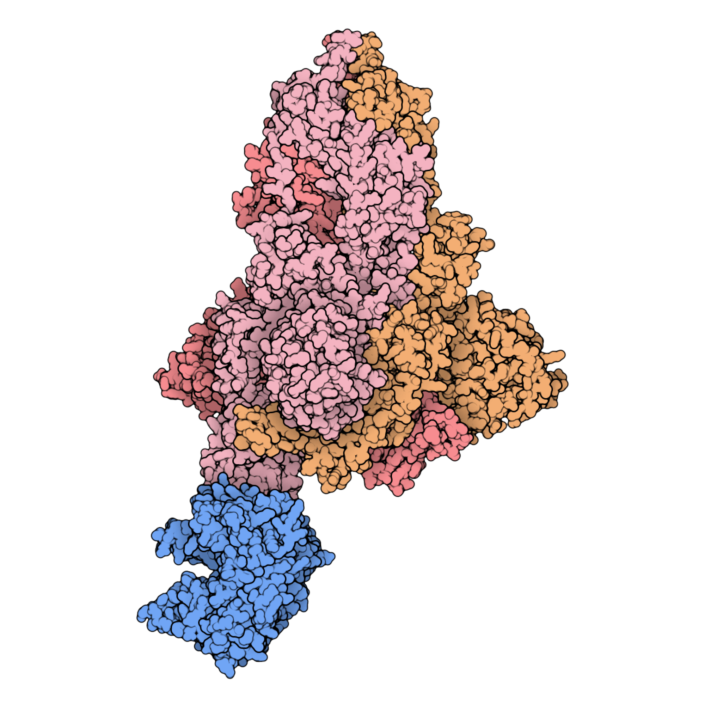
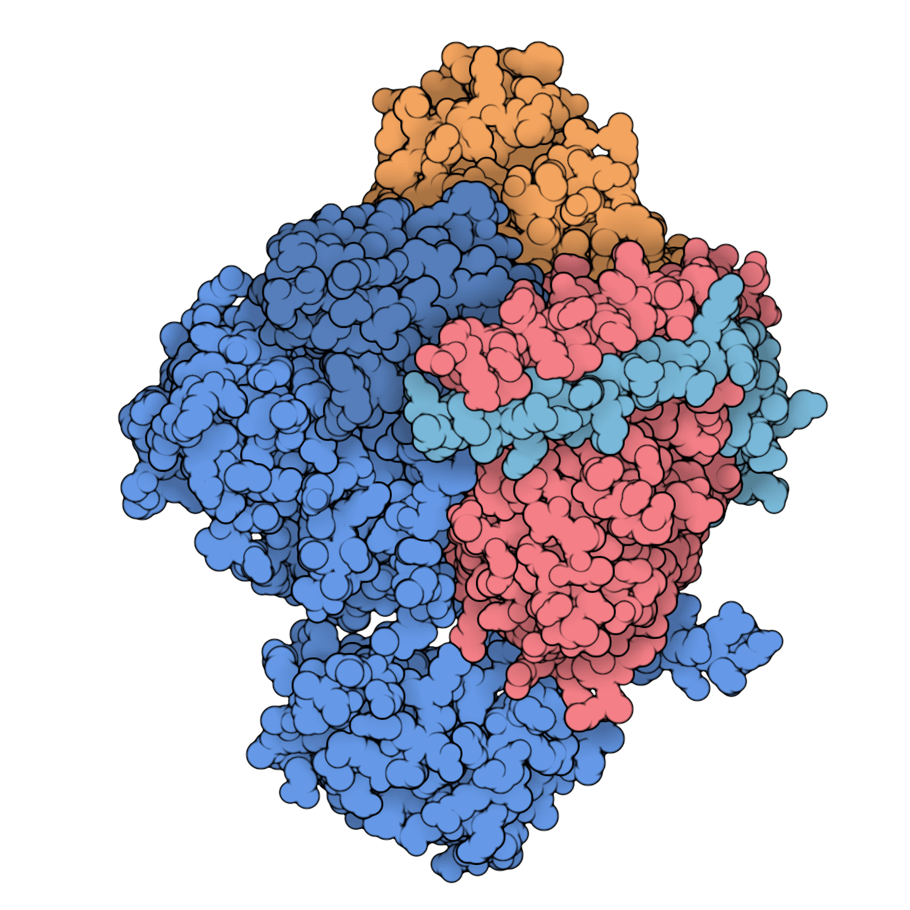
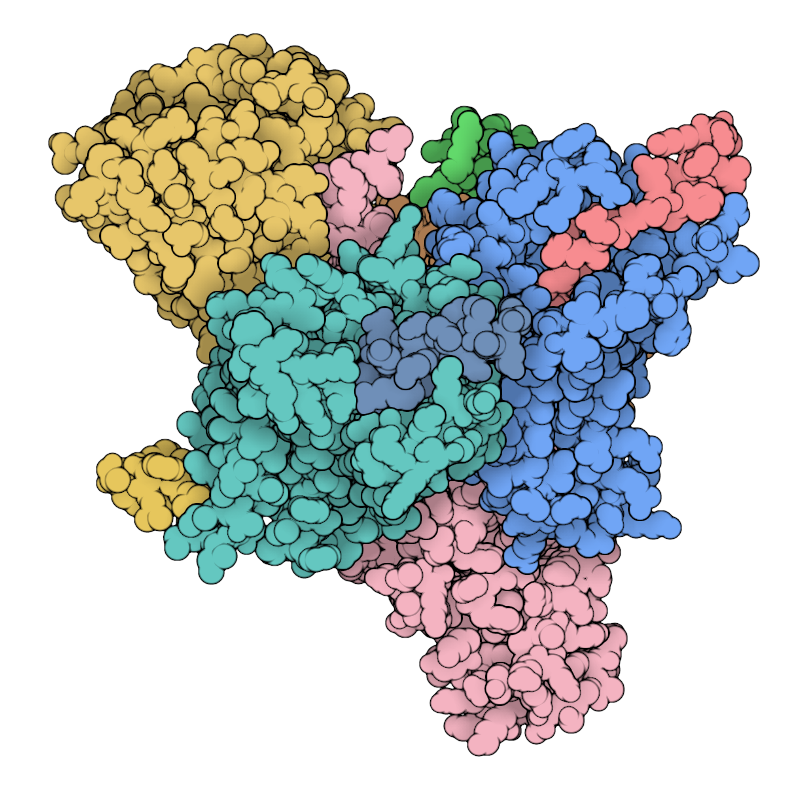

<p align="center"></p>

# Illustrate for ChimeraX

[English](README.md) | 简体中文

把当前 [ChimeraX](https://www.cgl.ucsf.edu/chimerax/) 场景一键变成扁平配色、黑色轮廓的分子插图，风格来自 [Illustrate](https://github.com/ccsb-scripps/Illustrate)。不用再手写、反复修改 `.inp` 文件：在 ChimeraX 里调好视角，捕获，导出 PNG 即可。

## 效果展示

<table>
<tr><td align="center"><a href="docs/images/gallery/7K00.png"></a><br><sub><b>7K00</b> · 大肠杆菌 70S 核糖体<br>核酸碱基对比</sub></td><td align="center"><a href="docs/images/gallery/7E2Y.png"></a><br><sub><b>7E2Y</b> · 血清素 5-HT1A 受体–Gi 复合物<br>冷暖复合物</sub></td></tr>
</table>

<table>
<tr><td align="center"><a href="docs/images/gallery/5T0C.png"></a><br><sub><b>5T0C</b> · 人 26S 蛋白酶体<br>月度分子光谱</sub></td><td align="center"><a href="docs/images/gallery/1LP3.png"></a><br><sub><b>1LP3</b> · AAV-2 衣壳<br>单色蓝系列</sub></td><td align="center"><a href="docs/images/gallery/1AON.png"></a><br><sub><b>1AON</b> · GroEL/GroES 伴侣蛋白<br>单色蓝系列</sub></td></tr>
<tr><td align="center"><a href="docs/images/gallery/7DF4.png"></a><br><sub><b>7DF4</b> · 新冠刺突蛋白 + ACE2<br>经典链配色</sub></td><td align="center"><a href="docs/images/gallery/3SN6.png"></a><br><sub><b>3SN6</b> · β2 肾上腺素受体–Gs 复合物<br>冷暖复合物</sub></td><td align="center"><a href="docs/images/gallery/8F7Q.png"></a><br><sub><b>8F7Q</b> · μ 阿片受体–Gi 复合物<br>经典链配色</sub></td></tr>
</table>

均使用本插件，由 [RCSB PDB](https://www.rcsb.org/) 的结构生成（点击图片查看原图）。7E2Y 中胆固醇为棕色，结合的脂质为紫色。

## 主要特点

- **从当前场景一键生成。** 捕获以 atom、cartoon 或 molecular surface 显示的内容，沿用当前视角和颜色。
- **智能配色。** 五套配色方案按链着色，并且*单独*给配体、脂质、糖上色，配体不会再和受体混成一色。
- **默认就简单。** 捕获、选导出尺寸、导出。轮廓、边界、阴影、雾化收在可折叠的“高级设置”里。
- **任意尺寸观感一致。** 透明 PNG 从 300 到 16000 像素，实时预览与导出一致。
- **可脚本化。** `illustrate save out.png` 可用于脚本和 `ChimeraX --nogui`。
- 中英文界面。

## 安装

从 [Releases 页面](https://github.com/Jaaayden/ChimeraX-Illustrate/releases/latest)下载最新的 `.whl` 文件，然后在 ChimeraX 命令行中执行：

```text
toolshed install ~/Downloads/chimerax_illustrate-0.1.28-py3-none-any.whl
```

重启 ChimeraX，再输入 `illustrate`。需要 ChimeraX 1.10 或更高版本。

<details>
<summary>改用源码安装</summary>

```bash
cd ~
git clone https://github.com/Jaaayden/ChimeraX-Illustrate.git
```

然后在 ChimeraX 中执行 `devel install ~/ChimeraX-Illustrate` 并重启。请勿添加 `editable true`；在 ChimeraX 1.12 中，它可能导致重启后无法导入 `illustrate` 模块。
</details>

## 更新

1. 用 `toolshed list installed` 查看当前版本（找 `Illustrate (x.y.z)` 一行）。
2. wheel 安装的：下载新版 `.whl`，再执行同样的 `toolshed install` 命令，会直接替换旧版本。源码安装的：在 `~/ChimeraX-Illustrate` 里 `git pull`，再执行 `devel install ~/ChimeraX-Illustrate`。
3. 重启 ChimeraX。

仍是旧版本的话，在 `toolshed install` 命令后加 `reinstall true`，或先执行 `toolshed uninstall ChimeraX-Illustrate`。

## 快速开始

1. 在 ChimeraX 中打开结构，用 atom、cartoon 或 surface 显示。
2. 输入 `illustrate`。需要的话选一个配色方案，点“应用配色”。
3. 点“捕获当前场景”；想换视角，调整 ChimeraX 视图后再捕获一次。
4. 选择“导出尺寸”，点“导出 PNG”。

想微调效果？展开“高级设置”（轮廓、边界、阴影与雾、常规），一边看预览一边调。

## 配色方案

| 方案 | 适合 |
| --- | --- |
| **经典链配色** | 日常使用：每条链一种柔和的粉彩色 |
| **冷暖复合物** | 受体与配偶体、多亚基复合物 |
| **核酸碱基对比** | 核糖体、DNA/RNA 复合物：骨架按链着色，碱基为浅色 |
| **月度分子光谱** | 大型分子机器：按链顺序蓝、绿、紫、品红、暖色 |
| **单色蓝系列** | 对称装配体、衣壳 |

蛋白和核酸按链上色。其他分子按类型上色：每种小分子有自己醒目的颜色（所有拷贝相同），甾醇共用一种棕色，其他脂质共用一种米色，糖共用一种浅蓝色。水、离子、结晶添加剂和去污剂不上色，让颜色总数保持较少。

默认情况下，应用配色还会隐藏氢原子，并设置白色背景、柔和光照和轮廓线；取消勾选“应用配色时同时调整场景”（高级设置的“常规”分页）可只改颜色。

## 命令

```text
illustrate                                   打开工具窗口
illustrate capture                           捕获当前场景
illustrate save out.png [width 1200] [height 1200] [transparent true|false]
illustrate reset                             清除已捕获的场景
```

`illustrate save` 会等文件写完才返回；如果工具窗口里已有捕获的场景就导出它，否则直接导出当前场景。

## 开发

```bash
python3 -m unittest discover -s tests -t .
```

渲染器只用 NumPy；`tests/reference_render.py` 是一份慢速的参考实现，测试会拿渲染器与它逐像素对比。

## 许可

Apache License 2.0。渲染风格和算法参考自 [ccsb-scripps/Illustrate](https://github.com/ccsb-scripps/Illustrate)。
